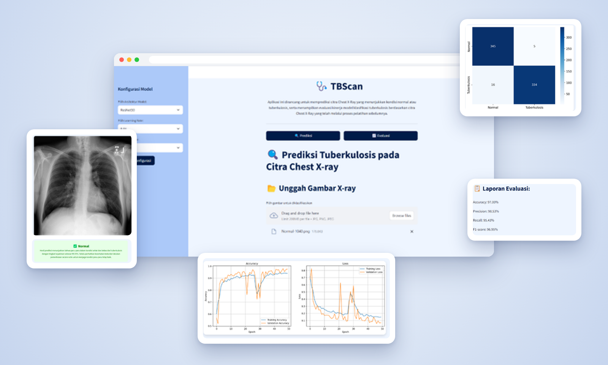
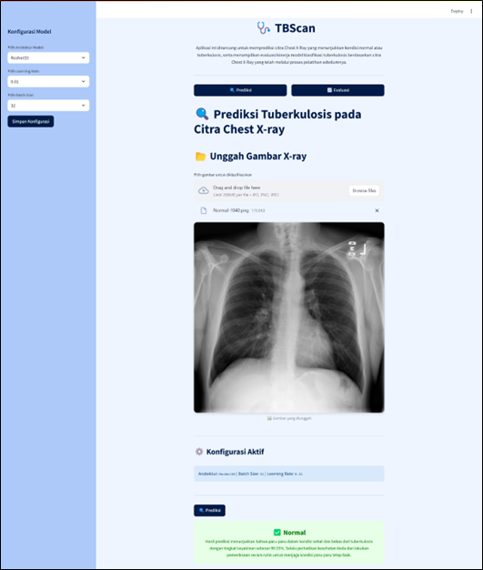
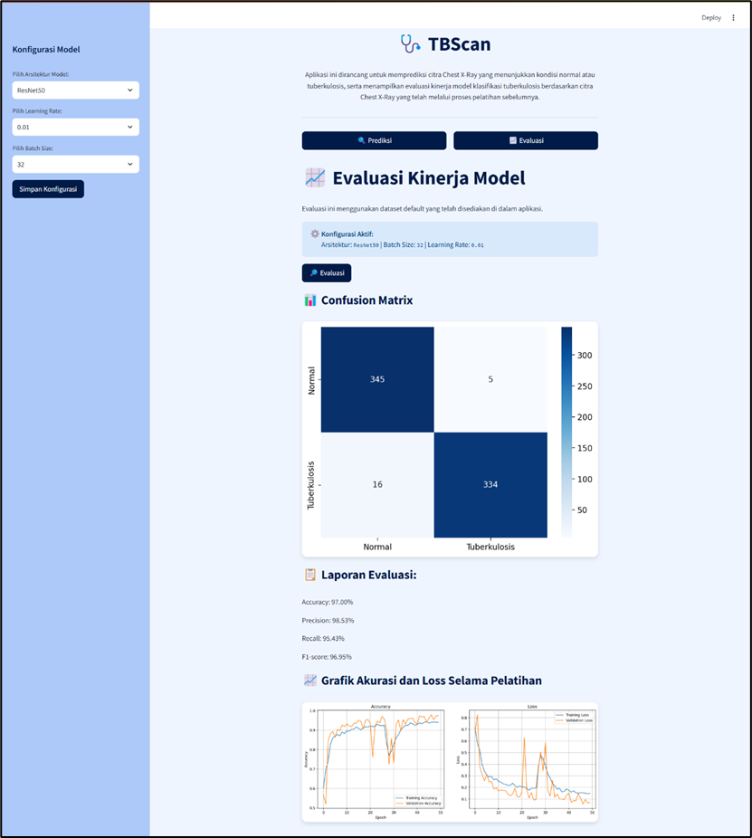

# 🩺 TBScan – Deteksi Tuberkulosis dari Citra Chest X-Ray

Aplikasi web berbasis **deep learning** untuk mengklasifikasikan citra rontgen dada (Chest X-Ray) ke dalam dua kelas: **Normal** atau **Tuberkulosis**. Aplikasi ini juga menampilkan evaluasi kinerja model klasifikasi yang telah dilatih sebelumnya.



## ✨ Fitur

- **Prediksi** – unggah citra Chest X-Ray (JPG, JPEG, PNG), lalu dapatkan hasil klasifikasi beserta tingkat keyakinannya.
- **Evaluasi** – tampilkan confusion matrix, laporan evaluasi (accuracy, precision, recall, F1-score), serta grafik akurasi dan loss selama pelatihan.
- **Konfigurasi model** – pilih arsitektur (VGG19, ResNet50, DenseNet121), learning rate (0.01 / 0.001), dan batch size (32 / 64) melalui sidebar.

## 📊 Hasil

Konfigurasi terbaik: **ResNet50 · learning rate 0.01 · batch size 32**

| Metrik | Nilai |
|---|---|
| Accuracy | **97,00%** |
| Precision | 98,53% |
| Recall | 95,43% |
| F1-score | 96,95% |

Confusion matrix (700 citra uji):

| | Prediksi Normal | Prediksi Tuberkulosis |
|---|---|---|
| **Aktual Normal** | 345 | 5 |
| **Aktual Tuberkulosis** | 16 | 334 |

## 🖼️ Tampilan

| Prediksi | Evaluasi |
|---|---|
|  |  |

## 🛠️ Teknologi

- Python
- TensorFlow / Keras (transfer learning: VGG19, ResNet50, DenseNet121)
- Streamlit
- NumPy, Pillow, Matplotlib, Seaborn, scikit-learn

## 📁 Struktur Proyek

```
tbscan/
├── tbscan_app.py           # Aplikasi utama Streamlit
├── app.py
├── model_handler.py        # Memuat model sesuai konfigurasi
├── prediction_handler.py   # Logika prediksi citra
├── evaluation_handler.py   # Confusion matrix, metrik, grafik pelatihan
├── style.css               # Tampilan antarmuka
├── requirements.txt
└── docs/                   # Gambar untuk README
```

## 🚀 Menjalankan Aplikasi

1. Clone repositori:
   ```bash
   git clone https://github.com/Annisaads/tbscan.git
   cd tbscan
   ```
2. Pasang dependensi:
   ```bash
   pip install -r requirements.txt
   ```
3. Siapkan file model (lihat catatan di bawah).
4. Jalankan aplikasi:
   ```bash
   streamlit run tbscan_app.py
   ```

### Catatan file model

File model hasil pelatihan **tidak disertakan** di repositori karena ukurannya besar (±230–700 MB per file). Letakkan file model di folder yang dibaca oleh `model_handler.py`, dengan pola nama:

```
<Arsitektur>_lr<learning rate>_bs<batch size>.h5           # contoh: ResNet50_lr0.01_bs32.h5
history_<Arsitektur>_lr<learning rate>_bs<batch size>.npz  # riwayat pelatihan untuk halaman Evaluasi
```

## 👩‍💻 Pengembang

**Annisa Dwi Septiani, S.Kom.** – Teknik Informatika, Universitas Sriwijaya

Proyek skripsi, 2025.
